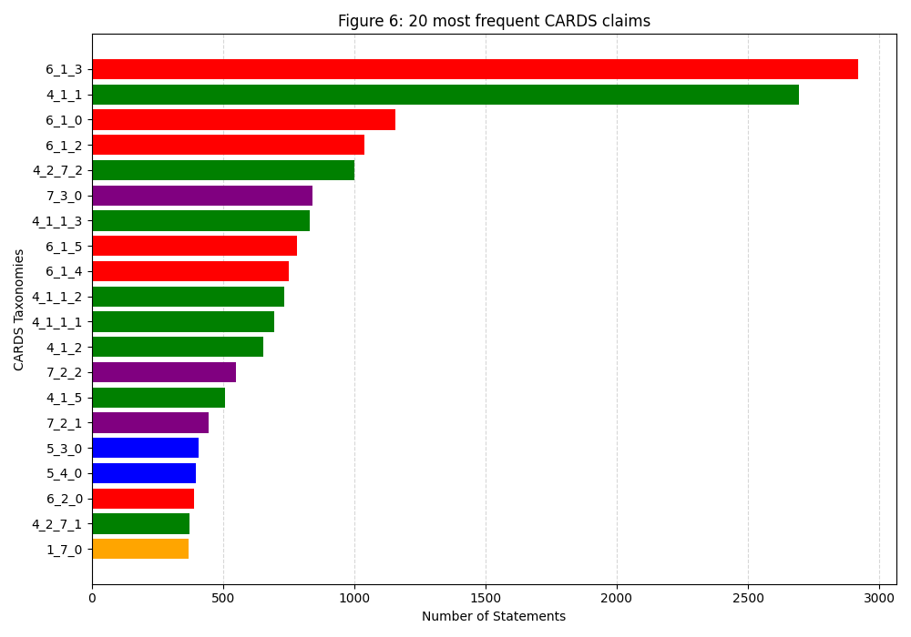
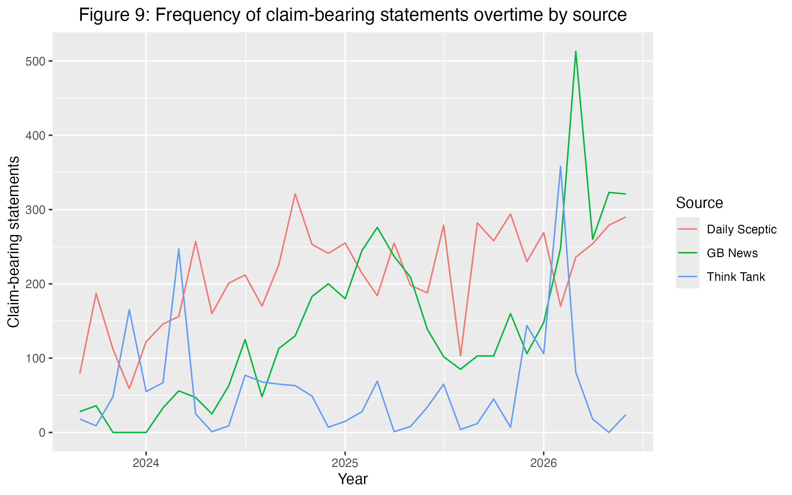
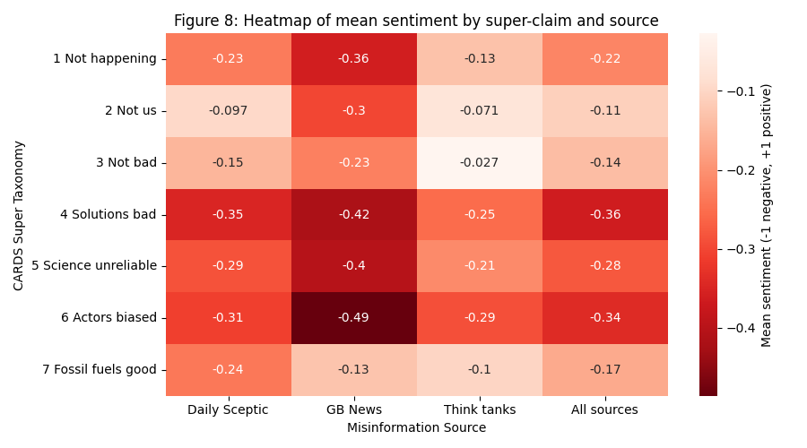
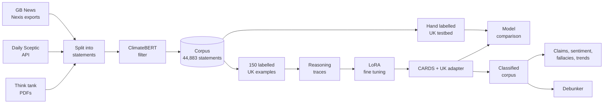

# Climate misinformation in UK media: detection, analysis and automated debunking

An end to end NLP pipeline that builds a corpus of UK climate discourse, classifies
contrarian claims with a fine tuned large language model, analyses how those claims
vary by source and over time, and generates structured debunkings.

This is the research consultancy project I carried out for my MSc Security and Data
Science at the University of Exeter (May to September 2026). The MSc ends in a
consultancy placement in place of a traditional dissertation: I scoped the problem with
the client, designed the method, built the full pipeline and delivered the findings. The
repository contains the parts of that work built on public sources. Client data and the
client specific deliverables are not included.

## Summary

Published classifiers of climate contrarian claims are trained largely on US think
tanks and blogs. Applied to UK media they miss claims specific to UK discourse, such
as attacks on named ministers over net zero policy and advocacy for North Sea oil and gas.
This project:

1. Builds a corpus of **44,883 climate statements** published between September 2023
   and June 2026 by GB News, the Daily Sceptic and five think tanks (GWPF, Net Zero Watch,
   IEA, Centre for Policy Studies, Adam Smith Institute).
2. Hand labels a **1,002 statement UK testbed** against the CARDS taxonomy, twice, four
   weeks apart.
3. Fine tunes the published CARDS classifier (a 27B parameter Qwen model) with a
   **LoRA adapter trained on 150 UK statements**, using reasoning traces generated to
   match the model's own training format.
4. Classifies the full corpus and analyses claim prevalence, sentiment, reasoning
   fallacies (FLICC) and trends over time.
5. Adapts a published "truth sandwich" debunker to produce a fact, myth, fallacy, fact
   response for any classified statement.

## Results

**The UK adapter improves on both baselines on UK text.**

| UK testbed (n = 1,002) | F1 | Precision | Recall | Exact match | MCC |
|---|---|---|---|---|---|
| Published CARDS model | 0.805 | 0.838 | 0.794 | 0.700 | 0.764 |
| **CARDS + UK LoRA adapter** | **0.849** | **0.868** | **0.846** | **0.760** | **0.816** |
| Claude Sonnet 4.6, zero shot | 0.803 | 0.797 | 0.837 | 0.673 | 0.736 |

The gain over the published model is significant (Wilcoxon signed rank test on per
statement F1, p < 0.001). It comes at a cost on the original US benchmark, where F1 on
the CARDS congressional test set falls from 0.848 to 0.809, so the adapter is a
specialisation for UK discourse and not a general improvement. Intra rater agreement on
the testbed was κ = 0.68 on full code sets and κ = 0.82 at super claim level.

**What the corpus shows.**

* 31% of statements carry at least one contrarian claim. The rate is 74% in the Daily
  Sceptic, 26% across the think tanks and 18% on GB News.
* UK contrarianism is about solutions and motives, not the science. Of claim bearing
  statements, 56% argue that climate solutions will not work and 41% attack the
  climate movement or climate science as biased. The four science denial super claims
  together appear in 13%.
* GB News is rising fastest: claim bearing statements grew by about 100 per month for
  each year of the study period, and their share of its climate coverage rose by 3.7
  percentage points a year. The think tanks show no significant trend.
* From January 2026 the share of claims promoting fossil fuels rose by 10 percentage
  points while attacks on climate actors fell by 11.
* Claim bearing statements are markedly more negative in sentiment than the rest of the
  corpus (mean signed score of −0.31 against −0.02), and four fallacy types account for
  82% of them.







## Pipeline



Each folder has its own README with the scripts, inputs and outputs for that stage.

| Stage | Folder | What it does |
|---|---|---|
| 1. Corpus | `corpus/` | Scrapes the Daily Sceptic API, parses Nexis exports of GB News, extracts text from 210 think tank PDFs, splits documents into statements, filters to climate content with ClimateBERT and merges the result |
| 2. Testbed | `evaluation/` | Draws the stratified sample for hand labelling and measures intra rater reliability |
| 3. Fine tuning | `finetuning/` | Generates reasoning traces for the labelled UK examples and trains the LoRA adapter |
| 4. Classification | `classification/` | Runs the base model, the adapter or a zero shot baseline over any set of statements |
| 5. Model comparison | `evaluation/` | Multi label metrics, significance testing and error analysis |
| 6. Analysis | `analysis/` | Claim distribution, source composition, sentiment, FLICC fallacies and temporal trends |
| 7. Debunking | `debunking/` | Generates fact, myth, fallacy, fact debunkings grounded in retrieved evidence |

Run order within each stage:

```
corpus/         scrape_daily_sceptic.py
                clean_nexis_rtf.py  →  deduplicate_gbnews.py
                extract_pdf_text.py →  map_pdf_metadata.py
                split_statements.py →  filter_climatebert.py → merge_corpus.py
                corpus_composition.py

evaluation/     sample_testbed.py   →  (hand labelling)  →  intra_rater_kappa.py
finetuning/     generate_recot.py   →  train_lora.py
classification/ classify_cards.py, classify_zero_shot.py
evaluation/     compare_models.py

analysis/       filter_claim_bearing.py
                claim_distribution.py, source_composition.R
                sentiment_classify.py → sentiment_analysis.py
                flicc_classify.py     → flicc_analysis.py
                temporal_analysis.R

debunking/      extend_climate_fever.py, sample_claims.py → run_debunker.py
```

## Methods in brief

**Corpus construction.** Documents are split into paragraph level statements of 10 to
300 words. A ClimateBERT detector keeps statements with a climate probability of at
least 0.5, which retains 42% of GB News statements, 81% of the Daily Sceptic and 18% of
think tank text. Dropped statements are saved so the filter can be audited.

**Fine tuning.** The adapter uses the same LoRA configuration as the published CARDS
model (rank 16 on the attention and MLP projections, 3 epochs), so that any change in
accuracy can be attributed to the UK examples. Of the 150 training statements, 100 are
from GB News, the source the published model found hardest. None overlap with the testbed.
Reasoning traces were generated with Claude Sonnet 4.6 and kept only when the final
answer matched the gold labels exactly.

**Evaluation.** All three models receive the identical system prompt and reasoning
trigger at temperature 0. Metrics follow the CARDS paper: sample averaged F1, precision
and recall, exact match accuracy, Hamming loss and the Matthews correlation coefficient.

**Temporal analysis.** Monthly series are modelled with linear regression on time in
years. Volatility is compared across sources with Levene's test, the shift in January
2026 with a before and after model for each super claim, and the language behind that
shift with weighted log odds of bigrams.

**Debunking.** The debunker of Zanartu et al. is adapted to take the CARDS and FLICC
labels already assigned upstream, to run on a locally served Mistral model, and to
retrieve supporting evidence by cosine similarity from a Climate FEVER evidence base.
That evidence base is extended here with two UK specific conspiracy claims, on
geoengineering and aircraft contrails, with evidence from published Met Office statements.

## Reproducing the results

```bash
pip install -r requirements.txt
```

The evaluation and analysis scripts run directly from the label only data in
`data/public/`:

```bash
python evaluation/intra_rater_kappa.py
python evaluation/compare_models.py
python analysis/claim_distribution.py
python analysis/sentiment_analysis.py
python analysis/flicc_analysis.py
Rscript analysis/source_composition.R
Rscript analysis/temporal_analysis.R
```

Rebuilding the corpus needs the original source documents, which are not redistributed.
See [`data/README.md`](data/README.md). Classification, fine tuning and debunking need a
GPU. See [`docs/gpu_runs.md`](docs/gpu_runs.md). The adapter weights are too large for
GitHub, so only the adapter configuration is included.

## Tests and data checks

The cleaning steps have unit tests, and the merged corpus has to pass a set of data
quality checks before it is saved. Run the tests with:

```bash
pytest
```

`tests/test_split_statements.py` checks that statement splitting joins paragraphs broken
across pages, tidies whitespace, drops headings, keeps only statements of 10 to 300 words
and numbers statements correctly. `tests/test_checks.py` checks that the data quality
checks catch what they should.

`corpus/checks.py` runs at the end of `merge_corpus.py` and stops the run, before anything
is saved, if it finds missing values, duplicate IDs or statements, statements outside the
10 to 300 word range, or dates outside the study period. It also runs on any saved table,
including the public label file:

```bash
python corpus/checks.py data/public/corpus_results.csv
```

The tests run automatically on every push through GitHub Actions.

## Tools

Python (pandas, scikit-learn, Hugging Face Transformers, Unsloth, vLLM, LangChain,
sentence-transformers), R (tidyverse, tidytext, tidylo, huxtable, car), the Anthropic API,
and RunPod for GPU compute.

## Acknowledgements and sources

* **CARDS taxonomy and classifier**: Coan, Boussalis, Cook and Nanko (2021), "Computer
  assisted classification of contrarian claims about climate change", *Scientific Reports*,
  and the CARDS 2.0 model released by the Centre for Climate Communication and Data
  Science (`C3DS/CARDS-Qwen3.6-27B`).
* **Debunker and FLICC classifier**: Zanartu, Otmakhova, Cook and Frermann (2024),
  "Generative Debunking of Climate Misinformation", ClimateNLP. The files in `debunking/`
  are adapted from their released code and data, with changes listed at the top of
  `debunking/core.py`.
* **ClimateBERT**: Webersinke et al. (2021), `climatebert/distilroberta-base-climate-detector`.
* **Sentiment**: `cardiffnlp/twitter-roberta-base-sentiment-latest`.

## Licence

The code I wrote for this project is released under the [MIT Licence](LICENSE). That
covers the scripts in `corpus/`, `classification/`, `evaluation/`, `finetuning/` and
`analysis/`, along with `run_debunker.py`, `sample_claims.py` and
`extend_climate_fever.py` in `debunking/`.

It does not cover material that originates with others: `core.py`, `templates.py`,
`definitions.py`, `examples.py` and `climate_fever_cards.csv` in `debunking/` are
adapted from Zanartu et al. and remain subject to their terms, and the files in
`data/public/` are derived from third party publications and the CARDS test set.

## Author

Oliver Davies. MSc Security and Data Science (Distinction), University of Exeter.
